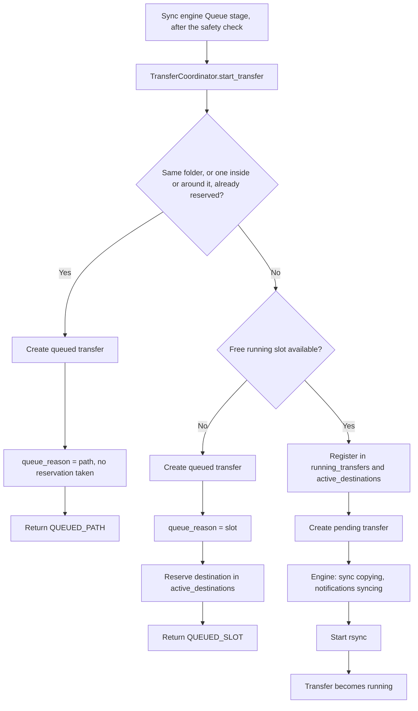
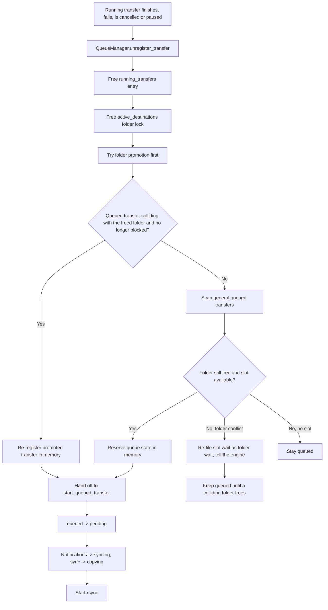
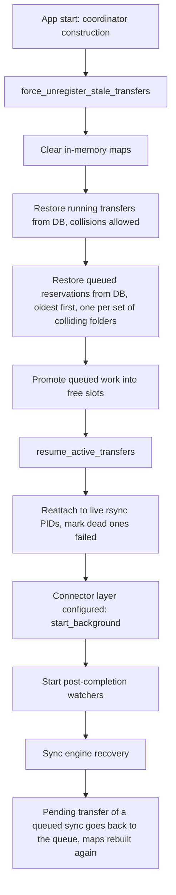

# Queue

Last updated: 2026-10-05

Every sync DragonCP runs waits its turn here before rsync starts. The queue
makes two promises: no two transfers it starts write into the same folder — or
into a folder and one inside it — at the same time, and no more than three
transfers run at once. Anything that cannot start yet waits with its reason on record: a
colliding folder is busy, or every slot is taken. When a transfer ends, pauses
or is cancelled, the queue starts the next one by itself, the one waiting on
that folder first. The queue is the Queue stage of the
[sync engine](../sync-engine/README.md): the engine decides when a transfer is
handed over, and nothing — a webhook, a press of Sync, a restart or a resume —
goes around it. A restore never waits: it refuses when its folder is busy or
every slot is taken.

## Where it lives

| Concern | File |
|---|---|
| Folder locks, the slot cap, promotion, rebuilding state at start-up | `services/queue_manager.py` |
| Admission (`start_transfer`), re-queueing a restarted row (`requeue_transfer`), starting a promoted transfer (`start_queued_transfer`), pause and resume, the completion watcher | `services/transfer_coordinator.py` |
| Handing a sync's transfer to the queue, and what each wait says on the sync | `services/sync_engine/engine.py` (`_queue_step`, `before_transfer_start`, `on_transfer_waiting`) |
| A sync's queued transfer after a DragonCP restart | `services/sync_engine/recovery.py` |
| A restore taking its folder, or refusing | `services/backups/service.py` (`_reserve`) |
| Starting rsync; reattaching to live rsync after a restart | `services/transfer_service.py` |
| Notification statuses that mirror the queue | `services/sync_engine/engine.py`, `models/webhook.py` |
| `transfers` rows and the `queue_reason` column | `models/transfer.py`, `models/database.py` |
| Cancelling a waiting transfer before its row is deleted | `routes/transfers.py` (`_cancel_before_delete`) |
| Folder-collision and start-up reservation tests | `tests/test_sync_engine.py` (`QueueOverlapTests`) |

## How it works

### 1. Two guarantees, held in memory

`QueueManager` keeps two process-local maps:
- `active_destinations`: `{normalized_dest_path: transfer_id}` — the folder locks
- `running_transfers`: `{transfer_id: normalized_dest_path}` — the running slots

These maps are the live authority used during admission and promotion. They
live in one process, which is one of the reasons DragonCP runs a single Gunicorn
worker (`AGENTS.md`).

Two destinations **collide** when they are the same folder or one is inside the
other (`QueueManager._overlaps`, decided 2026-10-02). A whole-series copy writes
every season folder, so it collides with a copy of any one season; two different
seasons of one show do not, and may copy side by side. Paths are compared whole
folder by whole folder, so `Example Show` does not collide with
`Example Show Two`. The cap is `MAX_CONCURRENT_TRANSFERS = 3`.

### 2. Admission

Every transfer the sync engine hands over arrives through
`TransferCoordinator.start_transfer()`, called from the engine's Queue stage
once the sync has passed its safety check. A restart arrives through
`TransferCoordinator.requeue_transfer()` instead, which reuses the existing row
and applies the same two checks.

**Folder check.** `QueueManager.check_duplicate_destination()` asks whether
another transfer holds a colliding destination. If one does:
- the transfer row is created with `status='queued'` and `queue_reason='path'`
- its `progress` names the transfer it waits for: `Queued: Waiting for "<title> - <season>" to complete (same destination path)`
- the call returns `QUEUED_PATH`, and the engine moves every notification on the sync to `QUEUED_PATH`
- no reservation is taken: a folder wait holds no lock of its own

**Slot check.** If the folder is free, `QueueManager.register_transfer()` decides
whether the transfer can run now. If all slots are full:
- the transfer row is created with `status='queued'` and `queue_reason='slot'`
- the destination is still reserved in `active_destinations`
- the call returns `QUEUED_SLOT`, and the notifications move to `QUEUED_SLOT`

That reservation is intentional: it stops a later transfer for a colliding
folder from being admitted ahead of the one already waiting.

**Immediate start.** If both checks pass:
- the transfer is registered in `active_destinations` and `running_transfers`
- the transfer row is created with `status='pending'`
- the coordinator tells the engine the copy is starting (`before_transfer_start`: the sync moves to copying and its notifications to `syncing`)
- `TransferService.start_rsync_process()` starts rsync and updates the row to `running`, and a completion watcher thread starts

The sync's Queue stage records which of the three happened, in words: all slots
busy, another transfer writing to the same folder, or started straight away.

### 3. Promotion

Promotion happens from `QueueManager.unregister_transfer()` after a running
transfer finishes, fails, is cancelled, or is paused. The order is always:
1. transfers waiting on the freed folder first
2. the general queue second

**Folder promotion — `_promote_same_path_queued(dest_path)`:**
- looks for queued transfer rows whose destination collides with the freed folder — the same folder, a season inside it, or the whole series it belongs to — skipping any already re-registered as running
- prefers transfers that are explicitly or implicitly folder waits, then oldest first
- walks that list and takes the first one that is no longer blocked: a whole-series copy may still be blocked by another season, while one later in the list may not be
- re-registers the promoted transfer in `active_destinations` and `running_transfers`
- hands it off to `TransferCoordinator.start_queued_transfer()`

`start_queued_transfer()` then performs the visible state transitions —
`queued` → `pending`, series notifications `QUEUED_*` → `syncing`, then the
engine's `before_transfer_start` for every notification on the sync — only after
queue ownership has been confirmed.

This re-registration step is the fix for issue `#40`: a promoted transfer must
reclaim in-memory queue ownership before rsync starts, otherwise a later
transfer can incorrectly see the folder as free.

**General promotion — `_promote_next_queued_transfer()`:**
- scans queued transfer rows oldest-first
- determines queue type from `queue_reason` first, then falls back to `progress` parsing for legacy rows
- skips a transfer already re-registered as running by a promotion still in flight, so the same queued transfer is never started twice
- re-checks the folder before promotion

If a slot wait now collides with a running transfer:
- it is re-filed from `queue_reason='slot'` to `queue_reason='path'`
- its `progress` text is updated
- linked series and anime notifications move from `QUEUED_SLOT` to `QUEUED_PATH` by transfer id, the older writer
- the engine is told (`on_transfer_waiting`): the sync's Queue stage now says it waits for a folder, and every notification on the sync — movies included — moves to `QUEUED_PATH`
- it stays queued until a folder promotion picks it up

If a queued transfer is promotable, its queue state is reserved before it is
started through `start_queued_transfer()`. Only one transfer is promoted per
pass.

**Defensive start guard.** `start_queued_transfer()` verifies that the promoted
transfer is already represented in the queue manager's running state
(`ensure_running_transfer_registered()`) before it starts rsync. This prevents
an untracked promotion from bypassing the folder rules.

### 4. Pause, resume, restart, restore

A pause is not an outcome, so it is handled differently from the rest:
`TransferCoordinator.pause_transfer()` releases the slot immediately rather than
waiting for the post-completion watcher, which only polls every few seconds — a
resume issued inside that window would otherwise be told the queue is full.
`_post_transfer_completion` then sees the paused status, releases the slot again
(unregistering twice is harmless) and stops, deliberately leaving notification
status and backup sorting alone because the transfer is expected to resume.

`TransferCoordinator.resume_transfer()` goes back through
`QueueManager.register_transfer()`, so a resume respects the concurrency cap and
cannot collide with a transfer that claimed a colliding folder while it was
paused. When no slot is free the transfer becomes `queued` again, as a slot
wait, and is promoted normally; when the folder is taken, the resume is refused
and the transfer stays paused.

A restart is a new sync in the engine: the safety check runs, then
`requeue_transfer()` puts the same row through the folder check and the slot
check exactly as a new transfer would — `queued` with `path` or `slot`, or
started with a fresh watcher. Until 2.3.0 a restart started rsync directly,
outside both checks. See [../transfers/README.md](../transfers/README.md).

A restore (`BackupsService._reserve`) runs the same two checks but never waits:
when a colliding folder is busy, or every slot is taken, it refuses with a
message saying which, because someone is watching it.

### 5. Start-up and restart recovery

Queue state is process-local, so start-up rebuilds it from the database:
1. `QueueManager.force_unregister_stale_transfers()`, during coordinator construction, clears both maps and re-registers every row still marked `running` as it is — even where one's folder is inside another's, because both are writing either way and refusing one would only hide it from the queue (`check_overlap=False`)
2. the same method then gives queued rows their reservations back, oldest first, with one owner per set of colliding folders: a row whose folder is the same as, inside or around one already reserved — by a running transfer or an older queued one — gets none, and waits as a folder wait (`_restore_queued_reservations_internal`). Folder waits are included, though they held no reservation before the restart
3. it promotes queued work into any free slots
4. `TransferService.resume_active_transfers()` reattaches to rsync processes that are still alive and marks the rest `failed`
5. once the connector layer is configured, `TransferCoordinator.start_background()` starts a completion watcher for each of those transfers, so queue release, notification updates, Discord announcements and backup sorting still happen
6. the sync engine's recovery leaves a sync whose transfer is still `queued` to carry on; a transfer left `pending` while its sync was still queued — promoted, and about to start when DragonCP stopped — is put back as a slot wait, and `force_unregister_stale_transfers()` runs again so it starts normally

This recovery closes the gap where a restarted app could have running rsync
processes but no in-memory folder reservations.

### 6. How notifications follow the queue

The engine writes these across every notification on the sync, movies included:
1. a batch waits in `pending` — held for a person, or in the ready check
2. a passing safety check moves it to `READY_FOR_TRANSFER`
3. admission returns `running`, `QUEUED_SLOT` or `QUEUED_PATH`, and the notifications follow
4. on promotion, they move to `syncing`
5. when the transfer ends, the sync's Finish stage marks them `completed`, `failed` or `cancelled`

The full table is in [../webhooks/README.md](../webhooks/README.md).

## Behaviour worth knowing

- **A folder wait holds no lock, so it can be overtaken.** A transfer queued for
  a folder conflict takes no reservation. A sync of another season of the same
  show can therefore start while a whole-series copy waits, and the whole-series
  copy starts only at a moment when no season of that show is copying.
- **After a restart, colliding queued transfers start one at a time.** Start-up
  gives the oldest of a set of colliding queued transfers the reservation and
  the others none, so a queued whole-series copy and a queued copy of one of its
  seasons cannot both hold one: the older starts, and the other waits behind it
  as a folder wait. Fixed 2026-10-05 — before, each got a reservation, each
  then found the other's in its way at promotion, and neither started until one
  was cancelled. Pinned by `tests/test_sync_engine.py`
  (`QueueOverlapTests::test_after_a_restart_a_series_and_its_season_do_not_block_each_other`).
- **Movie notifications name the right kind of wait.** When a slot wait is
  re-filed as a folder wait, the engine moves every notification on the sync to
  `QUEUED_PATH`, movies included. Fixed 2026-10-05; before, movie notifications
  kept `QUEUED_SLOT`.
- **Deleting a waiting transfer cancels it first.** A queued or paused transfer
  is cancelled before its row is deleted, so its reservation is freed, the queue
  promotes whatever was waiting on that folder, and its sync closes as
  cancelled. Fixed 2026-10-05 — before, the reservation stayed until a restart,
  and the sync stayed "In the queue", collecting later webhooks for that folder
  that never started. Details in [../transfers/README.md](../transfers/README.md).
- **Manual-sync-required is still `pending` plus a flag** (`requires_manual_sync`)
  rather than one explicit status.
- **Completion follows the sync, not the transfer id.** Every notification on a
  sync is closed by its Finish stage. The older transfer-id-based completion
  marking now runs only for transfers from before the engine, and still has the
  gaps described in [../webhooks/README.md](../webhooks/README.md).

## Data

`transfers` rows carry the queue's state:

| Column | Meaning |
|---|---|
| `status` | `pending` (admitted, about to start), `queued` (not allowed to start yet), `running` (rsync active), `paused` (stopped on purpose, partial files kept, expected to resume), `completed`, `failed`, `cancelled` |
| `queue_reason` | For `queued` rows: `path` (a colliding folder is being written) or `slot` (the concurrency cap). Stored at admission and rewritten when a slot wait is re-filed as a folder wait; added automatically to older databases at start-up |
| `progress` | The wait in words, e.g. `Waiting in queue...` or the `Queued: Waiting for …` line above |
| `sync_run_id` | The sync whose Queue stage handed the transfer over |

Promotion uses `queue_reason` as the primary classifier. Parsing the `progress`
text remains only as a fallback for rows from before the column existed —
without a persisted reason, queue logic has to infer intent from human-readable
text, which is fragile and can misclassify queued work.

Notification rows (`sonarr_webhook`, `radarr_webhook`) mirror the queue in their
`status`: `READY_FOR_TRANSFER`, `QUEUED_SLOT`, `QUEUED_PATH`, `syncing`.

## API

| Method | Path | Purpose |
|---|---|---|
| GET | `/api/transfers/active` | Running, pending, queued and paused transfers, plus the queue status |
| GET | `/api/transfers/queue/status` | The queue status only |

Queue status fields: `max_concurrent`, `running_count`, `queued_count`,
`available_slots`, `running_transfer_ids`, `queued_transfer_ids`,
`active_destinations`. `active_destinations` returns the transfer ids that own
reserved destinations, not the normalized paths themselves.

Socket events: `transfer_queued` (`transfer_coordinator.py`, on admission into
the queue) and `transfer_promoted` (`queue_manager.py`). What a sync's Queue
stage says while it waits is served by the
[sync engine](../sync-engine/README.md)'s endpoints.

## Related

- [../sync-engine/README.md](../sync-engine/README.md) — the pipeline whose Queue stage this is
- [../transfers/README.md](../transfers/README.md) — what happens once a transfer starts, restart and delete
- [../webhooks/README.md](../webhooks/README.md) — notification statuses
- [../../archive/auto-sync-flow-v3.md](../../archive/auto-sync-flow-v3.md) — the old scheduler and the queue fixes it records
- [../../reference/database-schema.md](../../reference/database-schema.md) — the `transfers` table
